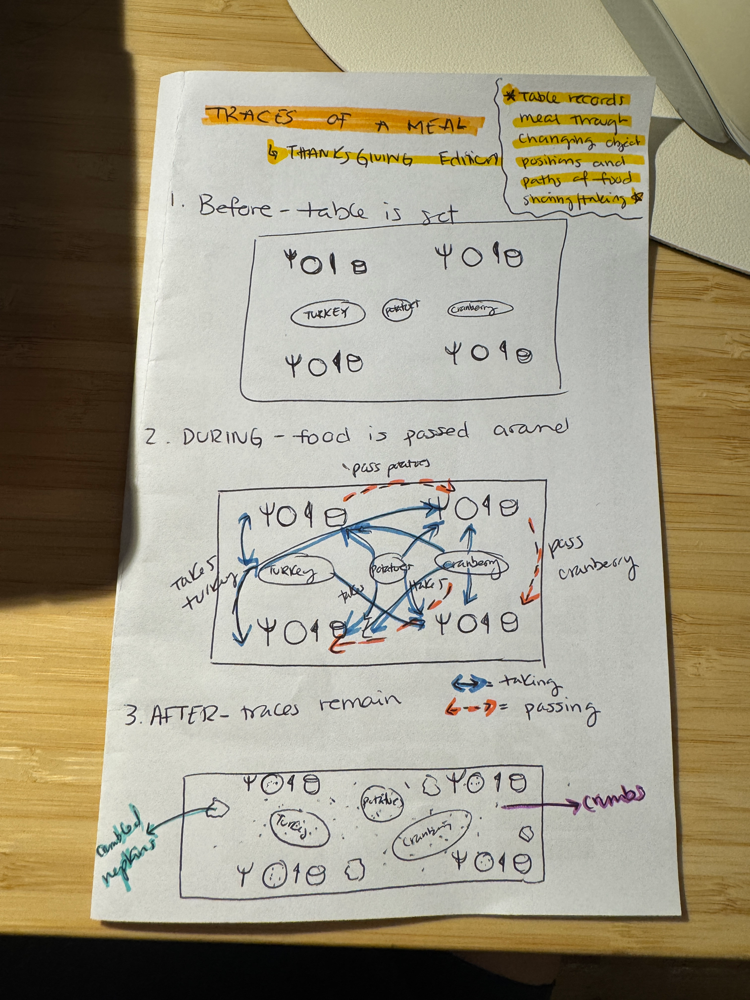

# Traces of a Meal
*Thanksgiving Edition*

A dinner leaves traces. As people take food and pass dishes, objects shift, crumbs collect, and napkins are left behind. The table becomes a record of the meal through the positions of objects and the paths between them.

I was inspired by Sarah Wigglesworth and Jeremy Till’s dining table drawings and created my own notebook sketch to test this phenomenon through code. Using simple HTML, CSS, and JavaScript, I turned the sketch into an imagined Thanksgiving dinner from 8:00 to 9:30 PM. The time slider lets you follow the meal, and “Show all paths” brings its movements together in one drawing.

## My sketch

## Why abstract?

I made the prototype more abstract to focus on movement and relationships rather than realistic food or people. Simple circles, shapes, dots, and lines make it easier to notice how the table changes over time. Solid blue arrows trace portions of food; dashed orange arrows trace serving dishes. Together, they turn everyday gestures into a visual memory of the meal.

## Open the prototype

[Open the prototype locally](http://127.0.0.1:8000/thanksgiving-table/)

This link works on my computer while the local preview server is running. To explore it on another computer, download this repository and open `thanksgiving-table/index.html` in a browser.
